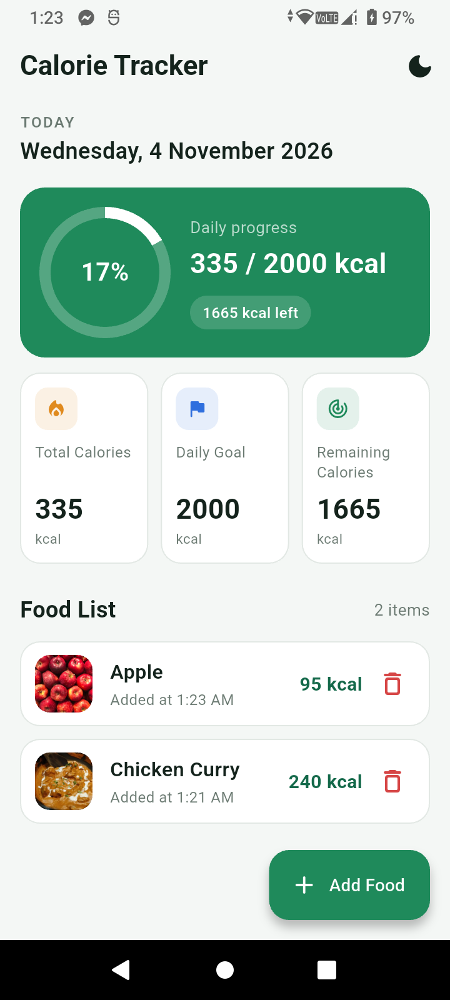
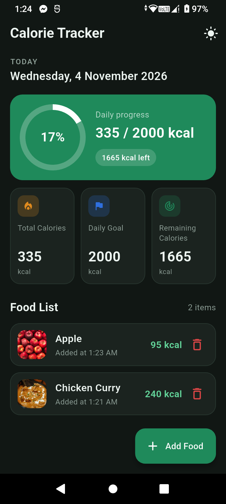
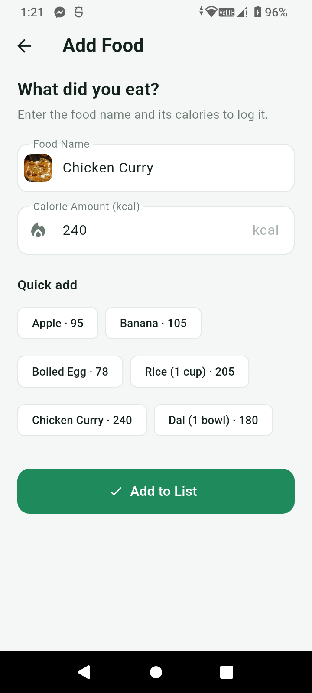
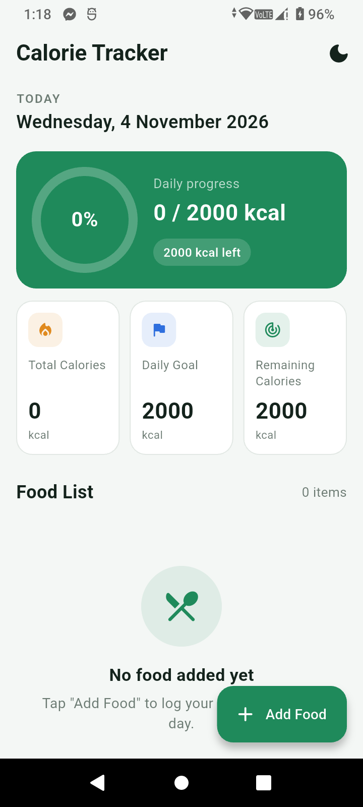

# 🥗 Calorie Tracker

A modern, responsive, and visually appealing Flutter application to log daily meals, track calorie intake in real time, and visualize daily nutrition goals with authentic food imagery.

[](https://flutter.dev)
[](https://dart.dev)
[](#testing)
[](#)
[](#)

---

## 📱 App Screenshots

### 1. Home Screen (Light vs. Dark Mode)
| Light Mode Home | Dark Mode Home |
| :---: | :---: |
|  |  |

### 2. Add Food & Real-Time Photo Match
| Live Food Photo Matching | Clean Empty State |
| :---: | :---: |
|  |  |

---

## ✨ Key Features

- **📸 Automatic Real Food Photography:**
  - Instantly detects food names and displays authentic, high-definition dish photos.
  - **Bilingual & Transliteration Support:** Recognizes both English names and colloquial Banglish/Bengali terms (*e.g., Kacchi Biryani, Shorshe Ilish, Dim Bhaji, Sada Bhat, Chingri Malai Curry, Fuchka, Chotpoti, Dudh Cha*).
  - **Dynamic Fallback Engine:** Generates realistic culinary presentations for any unique or unlisted custom dish on the fly.
  - **Word-Boundary Matcher:** Eliminates false substring matches (*e.g., "Pineapple" never matches "Apple", "Steak" never matches "Tea"*).

- **🌓 Dual Theme Engine (Light & Dark Mode):**
  - **Adaptive System Detection:** Automatically follows device system settings (`ThemeMode.system`).
  - **One-Tap Manual Toggle:** Seamlessly switch between themes anytime using the top AppBar icon button.
  - **OLED-Optimized Dark Palette:** Deep organic dark tones (`#111714` background, `#1B231F` card surfaces) designed for battery efficiency and night comfort.

- **📊 Visual Progress & Nutrition Analytics:**
  - Circular animated progress indicator displaying daily calorie consumption vs. the 2,000 kcal target.
  - Dynamic status badges showing remaining calories or goal completion.
  - Three real-time summary cards: *Total Calories*, *Daily Goal*, and *Remaining Calories*.

- **⚡ Streamlined Meal Logging:**
  - Fast-entry form with full input validation (food name required, positive numbers up to 5,000 kcal).
  - Quick-add chip presets for common everyday foods (*Apple, Banana, Boiled Egg, Rice, Chicken Curry, Dal*).
  - Live photo thumbnail preview directly inside the text field as you type.

- **🔄 Safe Management & Undo:**
  - Remove items with a single tap.
  - Snappy, non-blocking floating notifications with an immediate **UNDO** action.

---

## 📂 Project Architecture

```
calorie_tracker/
├── lib/
│   ├── main.dart                  # App bootstrap, theme notifier & root widget
│   ├── models/
│   │   └── food_item.dart         # FoodItem model with auto-resolved image URL
│   ├── screens/
│   │   ├── splash_screen.dart     # Branded launch screen with smooth fade transition
│   │   ├── home_screen.dart       # Main dashboard: date, summary, progress & list
│   │   └── add_food_screen.dart   # Input form with live photo match & quick-pick chips
│   ├── services/
│   │   └── food_image_service.dart# Prioritized regex engine, culinary library & generator
│   ├── theme/
│   │   └── app_theme.dart         # Complete Material 3 Light & Dark design tokens
│   ├── utils/
│   │   ├── constants.dart         # Calorie goal constants & app configuration
│   │   └── date_formatter.dart    # Human-readable date and timestamp formatting
│   └── widgets/
│       ├── calorie_progress_card.dart # Animated circular progress card
│       ├── empty_state.dart           # Illustrated empty state placeholder
│       ├── food_tile.dart             # Food card with thumbnail, calories & delete action
│       └── summary_card.dart          # Adaptive metric cards for dashboard stats
├── screenshots/                   # High-resolution application screenshots
└── test/
    ├── food_image_service_test.dart   # Unit tests for image resolution & Banglish mapping
    ├── theme_test.dart                # Unit & widget tests for Light/Dark mode toggling
    └── widget_test.dart               # Integration tests for dashboard, form & item deletion
```

---

## 🚀 Getting Started

### Prerequisites
- [Flutter SDK](https://flutter.dev/docs/get-started/install) (`^3.13.7` or later)
- Android Studio / VS Code with Flutter extension
- Connected Android/iOS device or emulator

### Installation & Run

1. **Clone the repository:**
   ```bash
   git clone https://github.com/Rohan2002-33/calorie_tracker.git
   cd calorie_tracker
   ```

2. **Install dependencies:**
   ```bash
   flutter pub get
   ```

3. **Run on your device:**
   ```bash
   flutter run
   ```

---

## 🧪 Testing

The application includes a comprehensive test suite covering food image matching, theme mode toggling, form validations, and user interaction flows.

Run all tests:
```bash
flutter test
```

Run static code analysis:
```bash
flutter analyze
```

---

## 📄 License

This project is licensed under the MIT License - see the [LICENSE](LICENSE) file for details.

